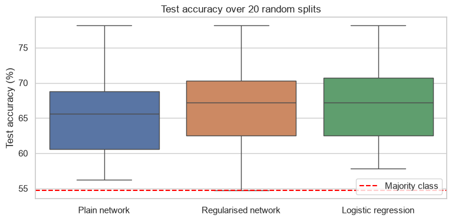
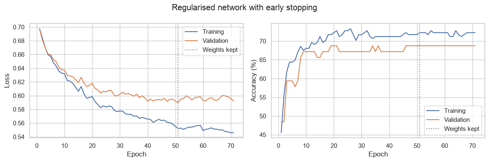

# Predicting listing gains in the Indian IPO market with PyTorch

Can the demand for an IPO, measured before it lists, tell you whether the share will open above its issue price? This notebook builds a binary classifier in PyTorch on 319 Indian IPOs from 2010 to 2022, and checks it against a much simpler model.

The project follows the brief of a Dataquest guided project. The analysis, code and conclusions are my own.



## Data

`Indian_IPO_Market_Data.csv`: one row per IPO, with the issue size, issue price, how many times the issue was subscribed by institutional (QIB), high net worth (HNI) and retail (RII) investors, and the listing gain in percent. The data was originally collected from moneycontrol and is distributed with the Dataquest project.

The target is 1 if the IPO listed above its issue price and 0 otherwise. 54.5% of the IPOs listed at a gain.

## Approach

1. **Exploration:** distributions by outcome, correlations, and the success rate by listing year.
2. **Preparation:** log-transform the heavily skewed features, split 60/20/20 with stratification, and fit the scaler on the training set only.
3. **Plain network:** three hidden layers (32, 16, 8), trained for 100 epochs.
4. **Regularised network:** the same shape with batch normalisation, dropout, weight decay and early stopping on the validation loss.
5. **Comparison:** logistic regression on the same features.
6. **Evaluation:** confusion matrix, precision, recall and ROC AUC on the held-out test set.
7. **Stability check:** the whole pipeline repeated over 20 random splits.

## Results

| | Plain network | Regularised network | Logistic regression |
|---|---|---|---|
| Train / validation accuracy | 77.5% / 68.8% | 72.3% / 68.8% | 69.1% / 73.4% |
| Test accuracy (single split) | 57.8% | 59.4% | 60.9% |
| Test accuracy (mean of 20 splits) | 64.9% | 66.5% | 67.0% |

The majority-class baseline is 54.7%.

- **There is real but modest signal.** Subscription levels, above all institutional demand, predict a listing gain about 10 to 12 points better than always guessing "gain".
- **Regularisation fixed the overfitting, not the accuracy.** The gap between training and validation accuracy fell from 8.7 to 3.5 points, but accuracy on unseen IPOs did not improve.
- **A neural network is not needed here.** Logistic regression matches or beats both networks. With six correlated features and 319 rows, extra capacity has nothing to learn.
- **One test score on 64 rows is not trustworthy.** The same pipeline scores anywhere from 55% to 78% depending on the split, with a standard deviation of about 6 points.
- **Time matters.** Only 34-40% of IPOs listed at a gain in 2010-2012, against about 70% in 2020-2022. A random split hides this; a real forecast would need a time-ordered split and some measure of market conditions.



## Running the notebook

```bash
pip install -r requirements.txt
jupyter notebook notebook.ipynb
```

Seeds are fixed, so the numbers above should reproduce on CPU. Small differences are possible between PyTorch versions.

This is a modelling exercise and not investment advice.

## License

The code is released under the [MIT License](LICENSE). Datasets keep the terms of their original sources, described above.
